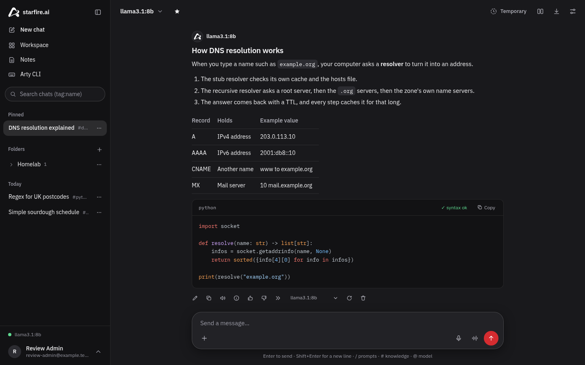

<div align="center">

# starfire.ai

**A terminal-themed chat for your own AI. Run local models on your own hardware, add hosted providers if you want them, and get tools, memory, documents, notes, automations and email in one place.**

[](https://www.python.org/)
[](https://fastapi.tiangolo.com/)
[](https://github.com/drew-codes-things/ArtyEngine)
[](desktop/README.md)
[](CHANGELOG.md)
[](https://github.com/drew-codes-things/starfire.ai/releases/tag/desktop-v1.0.0)
[](LICENSE)



</div>

---

## Contents

- [What it is](#what-it-is)
- [Two ways to use it](#two-ways-to-use-it)
- [Quick start](#quick-start)
- [What it can do](#what-it-can-do)
- [Limitations](#limitations)
- [Documentation](#documentation)
- [Releases](#releases)
- [License](#license)

## What it is

starfire is a chat app for you and the people you add. It finds a local model server on startup (ArtyEngine, or any
OpenAI-compatible server you add), and can also use hosted providers with API keys you enter in Settings. Nothing is
sent anywhere unless you add a hosted provider yourself. It is built on FastAPI with encrypted key storage.

## Two ways to use it

| | What it is | Get it |
|---|---|---|
| **Web app** | The starfire server. You run it once (on a home server, a PC or in Docker) and use it from any browser. | [Quick start](#quick-start) below, or the [install guide](docs/install.md) |
| **Desktop app** | starfire in its own window, with a tray icon, a quick-ask shortcut (Ctrl+Shift+Space by default), notifications and the link to Arty Desktop. It connects to a starfire server you already run. | [Downloads](https://github.com/drew-codes-things/starfire.ai/releases/tag/desktop-v1.0.0) for Debian (`.deb` or AppImage) and Windows, then [Set up starfire Desktop](desktop/README.md#set-up-starfire-desktop) |

The desktop app does not replace the server: start with the web app, then add the desktop app on any computer that
should have starfire in a window of its own. With the link to Arty Desktop on, the chat can look at your screen, open
pages in your browsers and control your PC, and each step waits for your click on that computer. See
[Arty, Arty CLI and starfire.ai](docs/arty.md#controlling-your-pc).

## Quick start

You need Python 3.12+ and, for local models, a local model server such as [ArtyEngine](https://github.com/drew-codes-things/ArtyEngine) (optional if you only use hosted
providers). The [install guide](docs/install.md) lists the optional extras.

```bash
git clone https://github.com/drew-codes-things/starfire.ai.git
cd starfire.ai
python3 -m venv .venv && source .venv/bin/activate
pip install -r requirements.txt
cp .env.example .env
python server.py
```

Then open [http://localhost:8080](http://localhost:8080). It listens on `127.0.0.1` only by default.

Or with Docker:

```bash
cp .env.example .env
docker compose up -d --build
```

The first time you open starfire it shows a setup page. Enter the one-time setup code from starfire's log, then choose
your name, email and a password (at least 10 characters). Until the admin account exists, every other page and API
call is locked, so set it up straight away. More in [Logging in and accounts](docs/accounts.md).

## What it can do

- Chat with local and hosted models, with branching, folders, side chats, voice calls, compare and presets
- Tools through MCP servers and built-in tools, with approval cards for anything that changes something
- Memory, documents and notes that the model can search and you can manage
- Scheduled prompts, email with rules, and local image, audio and video generation
- Several accounts, each with its own data, and app keys so Arty, ArtyCode and other apps can use starfire's models

The [feature list](docs/features.md) has the rest.

## Limitations

- The server listens on `127.0.0.1` only by default; opening it to other machines is your choice to make.
- Local models need hardware to match: small models call tools less reliably, and starfire says so when it matters.
- Controlling a PC needs starfire Desktop linked to Arty Desktop, an admin account and a local model.

## Documentation

| Page | What is in it |
|---|---|
| [Install](docs/install.md) | Requirements, running from source, Docker |
| [Logging in and accounts](docs/accounts.md) | First-run setup code, passwords, the admin and other accounts |
| [Model servers and providers](docs/model-servers.md) | How local model servers are found, hosted providers, hardware and pulling models |
| [App keys and the API](docs/remote-ai-to-starfire.md) | Keys for Arty, ArtyCode and other apps to use starfire's models through its OpenAI-compatible `/v1` API |
| [Interface](docs/interface.md) | Sidebar, model picker, message box, settings, keyboard shortcuts, command palette |
| [Chat](docs/chat.md) | Arty Auto, replies, code checks, status line, saved chats, prompts, compare, presets, usage |
| [Tools](docs/tools.md) | MCP servers, signing in to online services, built-in tools, tool levels |
| [Memory, knowledge and notes](docs/memory-knowledge-notes.md) | Facts, documents and notes, for you and for the model |
| [Audio and images](docs/media-generation.md) | Local image, audio and video generation |
| [Automations](docs/automations.md) | Scheduled prompts |
| [Email](docs/email.md) | IMAP and SMTP mail |
| [Arty, Arty CLI and starfire.ai](docs/arty.md) | How the three projects link together |
| [Backup and restore](docs/backup.md) | Downloading and restoring the data folder |
| [Configuration](docs/configuration.md) | Every environment variable |
| [Data and security](docs/data-and-security.md) | What is stored where and how |
| [Features](docs/features.md) | The full feature list |
| [Development](docs/development.md) | Tests and the build |
| [starfire Desktop](desktop/README.md) | Install, set up, link with Arty Desktop, build |
| [Changelog](CHANGELOG.md) | What changed in each release |

## Releases

The [releases page](https://github.com/drew-codes-things/starfire.ai/releases) holds two kinds of release. Server
releases are tagged `v1.x` (the current one is [v1.3.0](https://github.com/drew-codes-things/starfire.ai/releases/tag/v1.3.0))
and are the starfire server. Desktop releases are tagged `desktop-v1.x` (the current one is
[desktop-v1.0.0](https://github.com/drew-codes-things/starfire.ai/releases/tag/desktop-v1.0.0)) and carry the
starfire Desktop installers. They have separate version numbers.

## License

Apache License 2.0 - made by [Drew](https://github.com/drew-codes-things). You may use, change
and share starfire.ai, including commercially; see [LICENSE](LICENSE) for the full terms. If
you share it or anything built from it, keep the [LICENSE](LICENSE) and [NOTICE](NOTICE)
files, which credit its author, and say what you changed. The bundled third-party libraries
and fonts in `static/vendor/` (marked, DOMPurify, highlight.js, IBM Plex) keep their own
open-source licences, which sit next to them.
