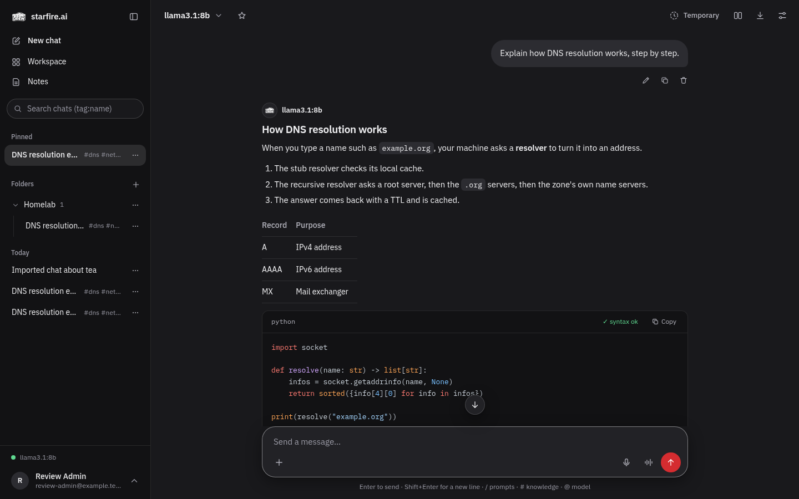

<div align="center">

# starfire.ai

**A terminal-themed local AI chat interface - runs local models through Ollama and optionally talks to hosted providers, with tool-calling, memory, documents, notes, automations, and email built in.**

[](https://www.python.org/)
[](https://fastapi.tiangolo.com/)
[](https://ollama.com/)
[](CHANGELOG.md)
[](LICENSE)

</div>



---

## Overview

A terminal-themed AI chat interface. Runs local models through [Ollama](https://ollama.com)
(auto-detected on startup - and started automatically if it's installed but not already
running - or add one manually) and optionally talks to hosted providers
(OpenAI, Anthropic, or any OpenAI-compatible API - Groq, OpenRouter, LM Studio, llama.cpp,
vLLM, ...) via API keys you add in Settings. Nothing is sent anywhere unless you add a
hosted provider yourself.

Built on FastAPI with encrypted key storage, as a local chat app for you and the people you add.

## Requirements

- Python 3.12+
- [Ollama](https://ollama.com/download), installed and running, for local models (optional
  if you only plan to use hosted providers)

## Setup

```bash
cd starfire.ai
python3 -m venv .venv && source .venv/bin/activate
pip install -r requirements.txt
cp .env.example .env
python server.py
```

Then open [http://localhost:8080](http://localhost:8080).

It listens on `127.0.0.1` only by default.

### Logging in

The first time you open starfire it shows a setup page: choose your name, email and a
password (at least 10 characters). That makes the admin account, and the setup page closes
for good. Until then, every other page and API call is locked, so set it up straight away
on a new install. After that, every page and API call needs a login (kept for 30 days in an
HttpOnly cookie; 5 wrong passwords lock that email from that address for 15 minutes). The
login and setup pages can load only the stylesheet, the logo and the fonts without a login.
Change your password under **Settings → Account**; that logs out every other browser. Forgot
it? Reset it from the terminal on the machine starfire runs on (this also logs out every
browser that was signed in):

```bash
python reset_password.py you@example.com
```

To copy logins from Open WebUI instead (same email and password - only the bcrypt hash is
copied):

```bash
python import_openwebui_users.py /path/to/open-webui/data/webui.db
```

Accounts are kept in
`data/users.json`. The cookie is `Secure`, so serve it over HTTPS (or `localhost`), or set
`COOKIE_SECURE=false` for plain HTTP on a trusted network. The shell tool runs as whichever
system user starfire runs as, so give it an unprivileged one.

### Accounts

The first account is the admin. Under **Settings → Accounts** an admin adds more people (name,
email, a starting password they can change later, and a role), resets a password, disables or
re-enables an account, and deletes one along with everything it owns.

Each account has its own chats, folders, memory, knowledge documents, notes and templates,
automations, email accounts and rules, prompts, presets, usage figures, attachments and
generated files, stored under `data/users/<id>/`. What's shared is the house's infrastructure:
model connections and their API keys, MCP servers, local image and audio setup, hardware and
backup. Only admins can change those; everyone can use them. Non-admins don't see the
Connections, Audio & Images, Hardware, Data and Accounts tabs, and the tools menu hides the
MCP server management for them.

Upgrading from a single-user install: on the first start your existing data moves into the
first admin's folder automatically. The Open WebUI import script now takes `--user EMAIL`
(default: the first admin).

If Ollama is already running on its default port, it's detected automatically on startup
and appears in the model list with no setup. Otherwise, open **Settings → Connections** and
either click **add ollama** (fills in the default endpoint, then Test/Add) or **scan
network** to probe common local model-server ports.

## Arty, Arty CLI and starfire.ai

These three projects are made to work together, and each one links to the other two.

| Project | What it is | What it does for the other two |
|---|---|---|
| [Arty](https://github.com/drew-codes-things/Arty) | The assistant: the brain and its API, tools, memory and voice, plus the desktop, Android, iPhone and Quest apps | Answers for both. Arty CLI and starfire.ai send their chats to Arty's API and use its models and tools. Arty's approve page sends a browser that has no Arty key to starfire.ai |
| [Arty CLI](https://github.com/drew-codes-things/ArtyCode) (ArtyCode) | Arty in your terminal: a coding agent that reads, edits and runs code in a project, asking first | Talks only to Arty. Logs in with an Arty API key, or by approving the computer in the browser. With `/remote` it shares a session through Arty, so starfire.ai and the Arty phone apps can follow and steer it |
| [starfire.ai](https://github.com/drew-codes-things/starfire.ai) | A web chat dashboard for local and hosted models | Lets you chat with Arty in the browser. Its admin-only **Arty devices** page approves a computer that is logging in (Arty CLI's browser login), lists and turns off approved devices, chooses which devices may control Arty CLI, and makes a new key with a QR code for a phone. Its admin-only **Arty CLI** page follows and steers shared Arty CLI sessions |

How to link them:

- **Arty to starfire.ai**: set `BRAIN_STARFIRE_URL` in the brain's `brain.env` to starfire's address, so the approve
  page can send people there.
- **starfire.ai to Arty**: add Arty under **Settings > Connections** with its address and API key, and set
  `ARTY_BASE_URL` in starfire's `.env` to exactly the same address (the **Arty devices** page needs it).
  `ARTY_PHONE_URL`, `ARTY_ACCESS_CLIENT_ID` and `ARTY_ACCESS_CLIENT_SECRET` are optional, for phone setup codes that
  work away from home.
- **Arty CLI to Arty**: set `ARTY_URL` (home network) or `ARTY_REMOTE_URL` (from anywhere, with
  `ARTY_ACCESS_CLIENT_ID` and `ARTY_ACCESS_CLIENT_SECRET` if Cloudflare Access guards it), then run `arty login`.

- **Controlling Arty CLI from elsewhere**: run `/remote` (or start with `arty --remote`) on the computer, then open
  **Arty CLI** in starfire's sidebar (admins only). It lists the computers sharing a session; open one to read what
  Arty is doing, answer its permission questions with **Allow** or **Deny**, send a message, or **Stop** the current
  turn. starfire uses its own Arty connection for this, so the browser never holds Arty's key. For a phone with its
  own device key, switch on **Arty CLI** for it on the **Arty devices** page.

Arty works without the other two. Arty CLI needs Arty. starfire.ai works with other models on its own, but its
**Arty devices** and **Arty CLI** pages need Arty.

## Adding a hosted provider

Settings → Connections → "Add API provider": pick OpenAI, Anthropic, or "Other
(OpenAI-compatible)", paste an API key, Test, then Add. The key is encrypted at rest - see
below.

## Interface

The layout is the familiar chat-app one: a collapsible sidebar of chats on the left, a compact
model picker in the header, a centred conversation and a rounded message box. A new chat opens
on a centred greeting with the message box in the middle and four suggestion chips under it;
after the first message the box sits at the bottom. Everything is drawn from one set of design
tokens (colours, radii, spacing, shadows) in `static/style.css`, with a dark and a light set.

- **Sidebar**: new chat, Workspace and Notes shortcuts, search (`tag:name` searches by tag),
  pinned chats, folders (drag a chat onto one; "New chat here" from a folder's menu), and chats
  grouped Today, Yesterday, Previous 7 days, Previous 30 days and then by month. Each chat's
  `···` menu has pin, rename, clone, tags, move to folder, download (.json/.md), archive and
  delete (with a confirmation). On phones the sidebar is a slide-over drawer with a scrim.
- **Account menu** (bottom of the sidebar): Settings, Archived chats, Keyboard shortcuts and
  Log out, under your name and email.
- **Model picker**: searchable; the star sets the default model. Presets show up under it as
  workspace models. A chat reopens on the model it was last used with.
- **Message box**: grows with its text up to a cap. `/` inserts a saved prompt, `#` attaches a
  Knowledge document, `@` sends the next message to a different model. **+** uploads files
  (text files are attached inline; PDFs are added to Knowledge and attached) and toggles tools
  - web search, deep research, image generation and the rest - with the active ones shown as
  chips. Files can also be dropped or pasted in. The microphone dictates; the waveform button
  is a hands-free voice conversation (browser speech recognition and speech synthesis). The
  send button turns into a stop button while a reply streams. If a message fails to send, its
  text is put back in the box.
- **Messages**: yours sit in a soft bubble on the right; replies are plain full-width text
  under the starfire mark and the model name, with a typing indicator until the first words
  arrive. Actions (copy, edit, read aloud, info, rate, continue, delete) appear on hover and
  are always visible on touch screens; regenerate, with its model chooser, is on the newest
  reply only. Deleting a message asks first.
- **Side chats**: type `/side` or `/btw` (with or without a question) to ask something on the
  side. The side chat sees the chat so far, nothing in it is saved, and the main chat is left
  as it was; "Back to chat" (or "Toggle side chat" in the command palette) returns to it.
- **Header buttons**: temporary chat (never saved to history), compare models, download the
  current chat as .json (re-importable), .md or .txt, and chat controls (system prompt plus
  temperature, top p, top k, max tokens, context length, repeat penalty and seed; Ollama takes
  all of them, OpenAI-compatible APIs and Anthropic take the ones they support). Controls are
  kept per chat: what you set on a new chat is your default, each saved chat keeps its own
  copy, and "Use my defaults" and "Save as my defaults" move settings between the two. Chats
  saved before this existed use your defaults.
- **Settings**: a tabbed dialog. General (chat behaviour, shortcuts, version), Appearance
  (System, Light or Dark theme; chat bubbles; wide chat), Account (who you are, change
  password), Chats and Usage; then Workspace (Models, Knowledge, Prompts, Tools), Personal
  (Memory, Notes, Automations, Email) and, for admins, Admin (Connections, Audio & Images,
  Hardware, Data, Accounts). Each tab loads its data when you open it.
- **Themes**: the stored theme is applied before the page paints, so there is no flash; System
  follows the operating system and switches live. The login and setup pages use the same theme.
- **Feedback**: copy, save and error messages show as short toasts. Confirmations use
  starfire's own dialog, and everything that removes something asks first. An offline banner
  appears when the server cannot be reached.
- **Approvals**: a shell command or file edit that is waiting for your answer is drawn again
  when the page loads, so a reload or a second device does not lose it.
- **Phones and tablets**: safe-area insets are respected, inputs are 16px so iOS does not zoom,
  menus open as bottom sheets, and every control is at least 44px tall.

### Keyboard shortcuts

`Ctrl+/` (or `Cmd+/`) shows this list in the app; it is also under the account menu.

| Shortcut | Action |
|---|---|
| `Ctrl+Shift+O` | New chat |
| `Shift+Esc` | Focus the message box |
| `Esc` | Close the top dialog or menu, or stop the reply that is streaming |
| `Enter` / `Shift+Enter` | Send / new line (swapped to `Ctrl+Enter` / `Enter` in Settings → General) |
| `Ctrl+K` | Command palette |
| `Ctrl+Shift+S` | Toggle the sidebar |
| `Ctrl+Shift+C` | Copy the last reply |
| `Ctrl+Shift+;` | Copy the last code block |
| `Ctrl+/` | Show the shortcuts |

## Chat

Every reply has a toolbar: **edit** (in place), **copy**, **listen**, **info** (model, time,
estimated size), **+1 / -1** rating, **continue** (extends the reply), **regenerate** (with any
model) and **delete**.

Code in a reply lands in its own box with the language, a **copy** button and a check result.
When a reply finishes, every fenced code block whose language starfire knows is parsed or
compiled on the server - Python (`compile`), JavaScript and TypeScript (`node --check`),
shell (`bash -n`), JSON, YAML, TOML and XML (parsers), Go (`gofmt -e`), C and C++
(`cc -fsyntax-only`), Ruby (`ruby -c`) and PHP (`php -l`) - and never executed. A block that
passes shows **✓ syntax ok**; a block that fails is sent back to the same model with the error,
up to twice, and the corrected version replaces it in the reply (**✓ fixed · syntax ok**, with
the original error in the tooltip). If it still fails, the original stays with **✗ syntax
error** and the line number, so you know before you paste. The copy button is disabled while a
block is being checked. Languages whose checker isn't installed on this machine are left
unmarked. Switch the whole thing off under **Settings → General**.

Your own messages have **edit**, **copy** and **delete**. Editing your
message or regenerating branches the conversation - rather than mutating history in place,
they create a new chat pointing back at the original up to that point (marked `↪` in the
sidebar). The send button becomes a stop button while a reply is streaming (`Esc` stops it too). Every conversation autosaves
as you go, and the history sent to the model is trimmed to the context length (8192 tokens
unless set in controls).

If a model likely doesn't support tool-calling (or is small enough - under ~3B parameters -
to be unreliable about *when* to use a tool rather than just answering directly), a banner
warns you before you enable tools for it, and the backend withholds the tools list from that
model's requests either way.

New chats get a title and up to three tags, and each reply can be followed by three suggested
follow-up questions you can click to send (all three can be switched off in Settings → General).
These small jobs go to the chat's own model unless `TASK_MODEL` is set, in which case they go
straight to that Ollama model instead. That keeps them out of an assistant's history and tool
loop (Arty's brain, for example): point it at the model the assistant already has loaded, with
`TASK_NUM_CTX` matching its context size, so Ollama doesn't load a second copy. Qwen3 models
are asked not to think for these (Ollama's `think: false`).

## Chats

Chats are saved automatically after each exchange. Settings → Chats exports every chat as
JSON, imports a starfire export or an Open WebUI chat export, archives all chats, lists tags,
and has a delete-all (you type "delete all" to confirm). A conversation you haven't sent a
message in yet is also kept as a local draft (browser `localStorage`) so a crash or an
offline moment before the first backend save doesn't lose it.

## Prompts

Workspace → Prompts stores reusable prompts under a `/command`. Typing `/command` in the chat
box inserts it, filling in `{{CURRENT_DATE}}`, `{{CURRENT_TIME}}`, `{{CURRENT_WEEKDAY}}` and
`{{CLIPBOARD}}`.

## Tools (MCP servers)

Settings → Tools lets the model call external tools via the
[Model Context Protocol](https://modelcontextprotocol.io). **Fetch** and **Memory** (two of the
three official reference servers) are installed and connected automatically on first run - just
enable their checkbox to use them in a chat. **Filesystem** (read/write within a directory you
choose) stays a manual "Quick add" since it needs that directory choice first.

An MCP server that is already running at a URL - the newer **streamable HTTP** transport or
the older **SSE** one - is added from the same **Custom MCP server** form: pick the transport,
paste the URL (for example `http://localhost:3001/mcp`) and, if the server wants one, an
`Authorization` header value. Local servers stay stdio: a command plus arguments.

Filesystem and MCP Memory need [Node.js](https://nodejs.org) (`npx`) installed locally; Fetch
needs [uv](https://docs.astral.sh/uv/) (`uvx`). Beyond those three, a **server repository**
dropdown lists other common MCP servers (Git, GitHub, GitLab, SQLite, Brave Search, Slack,
Puppeteer) with a per-server configure form for whatever it needs (an API key/token, a local
path, etc.) - or add any other stdio MCP server yourself by command + args. Enable a server's
checkbox to include its tools in the next chat message - supported for Ollama (models with
tool-calling support), OpenAI, and Anthropic.

The same Tools tab also has several built-in (non-MCP) tools - see Memory, Documents, Notes,
Automations, and Email below for most of them, plus:

- **Search the web** - a single no-API-key backend (DuckDuckGo's HTML results page); see
  `server_configs/web_search.py`. Swapping in a proper provider later is a one-function change.
- **Find images on the web** - DuckDuckGo image search (no API key). The model asks for a
  picture of something, the top usable result is downloaded on the server (images only, 15 MB
  cap, no private addresses) and stored with the other generated files, then shown in the chat
  with a link to the page it came from. Nothing is hot-linked from the model's own guesses.
- **⚠️ Run shell commands** - off by default. One general-purpose shell tool the model can call
  directly, the same way coding agents use one shell tool rather than a curated command
  set. **There is no sandbox under it** - it runs as your own user on your own machine, with
  only a timeout (120s) and an output-size cap as guardrails. By default every command the
  model proposes **waits in the chat for you to press "run it" or "reject"** (five minutes,
  then it is dropped); the model only sees the output once you approve. You can switch that
  off under the shell toggle if you really want it unattended. Only enable this in a chat (or
  an automation, see below) that won't also be reading untrusted content (a webpage, an email)
  in the same conversation - a tool the agent can call is reachable by prompt injection, and
  this one has no floor under it if that happens. `ssh host 'command'` through this same tool
  covers SSH; there's no separate SSH-specific tool.

### Tool levels for local models

Not every model can juggle fifteen tool schemas. starfire picks a level from the Ollama model's
parameter count (the `7b`, `14b` in its name) and tells you in a banner above the chat:

| Level | Models | What the model is given |
|---|---|---|
| none | under 3B, or known non-tool models | no tools at all, whatever you ticked |
| basic | 3B up to 12B | web search, knowledge, memory, notes, find/generate images, scheduled tasks, plus MCP servers, capped at 8 tools in total |
| full | 12B and up, and every hosted provider | everything you enabled |

The thresholds are two constants at the top of `server_configs/model_capabilities.py`.

## Memory

Settings → Memory is a persistent fact store - "user prefers dark mode", "user's dog is named
Rex" - that survives across chats. Add facts manually there, or just type `remember: ...` in
the chat (handled instantly, without calling the model at all). Enable "Remember & recall
facts" in Settings → Tools to let the model itself list, add, edit, delete, or search your
memory during a conversation. Search is keyword/token overlap by default - fast,
dependency-free, no setup - **optionally blended with semantic similarity** when a local Ollama
with an embedding model (`nomic-embed-text` by default) is reachable, so a paraphrase with no
shared words can still surface. No Ollama/embedding model pulled → falls back to exactly the
old keyword-only behavior, automatically, with no configuration needed either way.

## Knowledge (documents)

Settings → Knowledge lets you upload `.txt`, `.md`, or `.pdf` files, which are chunked and
indexed for the model to search. Enable "Search my documents" in Settings → Tools so the model
can pull in relevant passages while answering. Same keyword-search-by-default,
semantic-when-available behavior as Memory above.

## Notes

Settings → Notes is a to-do list / notes app - plain notes or checklists, with due dates,
repeat (daily/weekly/monthly/yearly), pinning, labels, and color. Due dates accept natural
language - "tomorrow", "next friday", "in 3 days", each optionally with "at 9am" / "at 14:30" -
as well as a plain `YYYY-MM-DD` or full ISO datetime; anything not recognized as one of those
phrases is assumed to already be an ISO date and passed through unchanged. Enable "Manage notes
& to-dos" in Settings → Tools to let the model add/update/delete/toggle items itself (using the
same natural-language dates).

**Templates** - save a note/checklist's shape (title, content or checklist items, type, label,
color, repeat) and instantiate it with one click instead of rebuilding a recurring structure by
hand. Five starter templates (Meeting notes, Daily to-do, Weekly review, Shopping list, Project
brainstorm) are seeded on first run.

Two things worth knowing:
- **Recurring due dates only advance while the Notes tab is open** - a lightweight timer
  checks for overdue repeating notes and pushes their due date forward one period at a time.
  The server never rewrites a due date on its own; only a browser tab open on the Notes page does.
- **No reminder popups, emails, or push notifications** - a proper reminder system is a large
  subsystem of its own (delivery channels, SSRF-guarded webhooks, a background poller, a dedup
  cache). starfire shows overdue/due-today notes with a highlighted badge in the list
  instead. If you want to be notified outside the app, that's not built.

## Audio & Images (local generation)

Settings → Audio & Images configures fully local image, audio, and video generation - no API key,
no hosted service, no content moderation layer other than whatever model you load:

- **Image** - via [ComfyUI](https://github.com/comfyanonymous/ComfyUI), a plain local server
  (same trust model as Ollama). Point starfire at your ComfyUI base URL and checkpoints
  directory; a generic URL-based downloader can pull any checkpoint file you give it a link to
  - starfire doesn't curate or recommend which ones. Low/medium/high quality presets trade off
  steps and resolution.
- **Audio** - via [Piper](https://github.com/rhasspy/piper), a one-shot local CLI (not a
  server) with low/medium/high quality voice variants you download per-voice.
- **Video** - no fixed built-in workflow (the ecosystem is too fragmented for one); export a
  working ComfyUI workflow graph as JSON, tell starfire which node/input holds the prompt text,
  and save it under a name. The `generate_video` tool then queues it by name.

Enable the corresponding tool (Generate image / Generate audio / Generate document) in Settings
→ Tools. If local generation isn't configured, image/audio generation fall back to OpenAI's API
(DALL-E/TTS) when a hosted OpenAI endpoint is configured - otherwise they're unavailable.

## Automations

Settings → Automations schedules a prompt to be sent to a model on a repeating basis (once,
daily, weekly, or a cron expression) and records what came back. Pick which tools that run may
use from the same list as chat (memory, documents, tasks, email, notes, web search, and - if you
choose to enable it - shell). There's no separate "run a shell command" task type;
a task is "send a prompt, with these tools available" and reuses the model's
normal tool-calling for that, one mechanism rather than two. The same warning as the chat
toggle applies: only give an automation the shell tool if it isn't also going to encounter
untrusted content - an automation runs unattended, so there is nobody to approve its commands
and they run straight away. The tool levels above apply to automations too.

## Email

Settings → Email connects a mailbox via IMAP/SMTP with an **app password** (Gmail, Outlook,
iCloud, Fastmail, or any provider that issues one - no OAuth, no Google Cloud project setup).
Once connected you get a simple inbox: browse folders, read, reply, send, mark read, archive,
delete, plus three on-demand AI actions per message - Summarize, Check Urgency, and AI Draft
Reply. Enable "Read & send email" in Settings → Tools to let the model do the same during a
conversation.

Every action opens a live IMAP/SMTP connection - there's no background inbox sync or caching,
so listing a folder takes a moment each time rather than being instant from a local cache.
That's the deliberate tradeoff for not needing a database or a background sync service.

## Compare

The **compare** button (header) opens a side-by-side view: one prompt, sent to as many
model/endpoint columns as you add, streamed in parallel. Useful for actually seeing how two
models answer the same thing rather than guessing.

## Deep Research & GitHub

Two more builtin tools in Settings → Tools:

- **Deep research** - searches the web, reads the top results, and returns a synthesized,
  cited report in one tool call. Slower and more thorough than the plain "Search the web" tool;
  use it for open-ended questions, not quick lookups.
- **GitHub (gh CLI)** - runs the `gh` binary only (not arbitrary shell), so the model can list
  issues, open PRs, check CI, etc. Needs `gh` installed and already authenticated
  (`gh auth login`) - this tool doesn't manage credentials itself.

## Presets

Workspace → Models (presets) saves the current (model + system prompt + enabled tools) as a named preset
you can reapply with one click, instead of reconfiguring the header and toggles every time.

## Usage

Settings → Usage shows estimated token counts and cost, today and all-time, broken down by
model. Token counts are estimated (~4 chars/token) and cost is looked up from a small static
price table for known hosted models - not a substitute for your provider's own billing page,
but enough to see where usage is trending. Ollama/local models always show $0.

## Hardware

Settings → Hardware detects this machine's RAM/VRAM (capacity - does a model fit?) and
CPU/GPU/RAM identity and speed (roughly, will it run well?), then suggests which common
Ollama-pullable models should actually work - instead of guessing and hitting an
out-of-memory error or a model that swaps to disk and crawls. Detection works on Linux, macOS,
and Windows; GPU VRAM/name needs `nvidia-smi` (NVIDIA only), and RAM speed/type needs
`dmidecode` **and root** on Linux specifically (macOS/Windows can read it as a normal user).

**Ollama status** is also shown here: if it's installed but not running, a **Start Ollama**
button launches it (no elevated privileges needed - same as running `ollama serve` yourself);
starfire also tries this automatically on its own startup. If Ollama isn't installed at all,
the tab shows the right install step for your OS (the official installer command on Linux,
a download link for macOS/Windows) - starfire won't run that installer for you, since Ollama's
own Linux installer needs `sudo`.

### Pulling models

Click **pull** next to any suggested model in the Hardware tab (or in Settings → Connections) to
download it through Ollama with a progress bar, same UX as Ollama's own CLI. To pull a model
manually instead - useful for scripting, a headless box, or a model not in the suggested
list - use Ollama's CLI directly:

```bash
ollama pull llama3.1:8b        # any model from https://ollama.com/library
ollama pull qwen2.5-coder:7b
```

A model pulled this way shows up in starfire's model list immediately; no restart needed.
`ollama list` shows what's already pulled, and `ollama rm <model>` removes one.

## Backup & restore

Settings → Data can download a zip of the whole `data/` directory, or restore one - the same
thing the manual "copy the data folder" step below does, through the UI. Restoring **overwrites
your current data** and can't be undone; back up first if you're not sure.

## Command palette

`Ctrl+K` / `Cmd+K` opens a fuzzy-filterable list of actions - new chat, export, open any
settings tab, compare models, toggle theme, keyboard shortcuts. Arrow keys to navigate, Enter
to run, Escape to close.

## Docker

The easiest way to run it in Docker is via the included compose file:

```bash
cp .env.example .env
docker compose up -d --build
```

A host-run Ollama is reachable from inside the container via `host.docker.internal`.
Data persists in `./data` on the host (mounted as a volume), so it survives container
rebuilds and restarts.

### Building the image manually

If you don't want compose, build and run the image directly:

```bash
docker build -t starfire.ai .
docker run -d -p 127.0.0.1:8080:8080 -v $(pwd)/data:/app/data --add-host host.docker.internal:host-gateway starfire.ai
```

To push the built image to a registry instead of just running it locally:

```bash
docker tag starfire.ai ghcr.io/<your-username>/starfire.ai:latest
docker push ghcr.io/<your-username>/starfire.ai:latest
```

(swap `ghcr.io/<your-username>` for Docker Hub's `<your-username>/starfire.ai` if you'd
rather use that instead)

## Configuration

| Variable | Default | Notes |
|---|---|---|
| `PORT` | `8080` | Port the server listens on |
| `BIND_HOST` | `127.0.0.1` | Address to listen on; keep it on loopback unless an account exists, since the shell tool can run commands |
| `COOKIE_SECURE` | `true` | Set to `false` to allow the login cookie over plain HTTP on a trusted network |
| `OLLAMA_BASE_URL` | _(auto-detect)_ | Override auto-detection with a specific Ollama URL |
| `DATA_DIR` | `./data` | Where endpoint config and encrypted API keys are stored |
| `TASK_MODEL` | _(chat's model)_ | Ollama model for titles, tags and follow-up suggestions |
| `TASK_NUM_CTX` | _(model default)_ | Context size for `TASK_MODEL`; match the loaded model's to avoid a reload |
| `ARTY_BASE_URL` | _(unset)_ | Arty's API address (for example `http://<arty-host>:8081/v1`). Must match an Arty connection under Settings > Connections that has Arty's API key; turns on the Arty devices page |
| `ARTY_PHONE_URL` | _(Arty's address)_ | The address a phone should use in the setup QR code made on the Arty devices page (for example Arty's public address) |
| `ARTY_ACCESS_CLIENT_ID` / `ARTY_ACCESS_CLIENT_SECRET` | _(unset)_ | Cloudflare Access service token put in the phone setup QR code, only when both are set |
| `OWN_TOOLS_MODELS` | `Arty,assistant-core,arty/*,own/*` | Comma-separated model ids (with `*` wildcards) that bring their own tools: the tools menu hides for them and starfire sends them none (`assistant-core` is Arty's old name, kept for saved chats; `own/*` are the brain's own models, which run with Arty's tools) |
| `INLINE_MEDIA_PREFIXES` | `/arty-files/` | Comma-separated path prefixes whose image and video links render inline in replies; links to another host with one of these paths load through this server instead |

Hosted-provider API keys are **not** set via environment variables - add them through the
Settings UI so they're encrypted at rest rather than sitting in plaintext in `.env`.

## Data & security

- `data/endpoints.json` - configured model endpoints (base URLs, non-secret).
- `data/api_keys.json` - API keys, encrypted with [Fernet](https://cryptography.io/en/latest/fernet/).
- `data/.key` - the per-install encryption key, `chmod 600` (owner-only).
- `data/mcp_servers.json` - configured MCP servers (command/args, non-secret).
- `data/users.json` / `data/sessions.json` - accounts (bcrypt hashes) and login sessions.
- `data/users/<id>/` - one folder per account holding that person's `memory.json`,
  `documents.json`, `tasks.json` / `task_runs.json`, `email_accounts.json` / `email_rules.json`
  (host/port/username, match/action config - all non-secret; the app password itself is
  encrypted in `data/api_keys.json` alongside provider API keys), `notes.json` /
  `note_templates.json`, `chat_sessions.json`, `chat_folders.json`, `presets.json`,
  `prompts.json`, `usage.json`, `generated_files.json` + `generated/`, and `attachments/`.
- `data/comfyui_config.json` / `data/piper_config.json` / `data/custom_workflows.json` - local
  image/audio/video generation config (see Local generation above); non-secret, no API keys
  involved.

Back up or delete the whole `data/` directory to reset the app (or use Settings → Data's
one-click backup/restore); deleting `data/.key` makes any stored keys unrecoverable.

## Features

- Multi-provider chat: Ollama (local or Ollama Cloud), OpenAI, Anthropic, and any
  OpenAI-compatible server, over one unified streaming UI
- Ollama auto-detected and auto-started on startup; one-click install guidance, manual add,
  or network-scan for anything else
- Light, dark and system themes from one token set, with no flash on load; toasts; a
  keyboard shortcuts sheet; an account menu; phone layout with a drawer and bottom sheets
- Chat-app layout: chat sidebar with folders, pins, tags, archive and date groups;
  searchable model picker with a default model; `/` prompts, `#` knowledge, `@` model
  mentions; file attachments; chat controls (system prompt + sampling params); temporary
  chats; `/side` and `/btw` side chats; hands-free voice call; reply rating, info, continue
  and in-place edit
- Conversation branching (edit/regenerate fork into a new session rather than overwriting
  history), autosaved chats with search, JSON export/import (including Open WebUI exports)
- Encrypted local API-key storage, no plaintext secrets on disk
- Tool-calling via MCP servers (filesystem, fetch, memory, a repository of common servers with
  per-server configure forms, or any custom stdio server), with a warning - and server-side
  enforcement - when the selected model likely can't use tools reliably
- Persistent memory (keyword-searchable facts) and document RAG (upload & search .txt/.md/.pdf),
  both usable by the model as tools or managed directly in Settings
- Scheduled task automation (once/daily/weekly/cron prompts, run history) and email
  (IMAP/SMTP with an app password: browse/read/send/reply/archive, rules that act on new mail
  automatically, plus on-demand AI summarize/urgency-check/draft-reply), both usable by the
  model as tools too
- Notes and checklists with due dates, repeat, pinning, labels, and reusable templates -
  usable by the model as a tool too
- Fully local image/audio/video generation (ComfyUI/Piper, no API key, no hosted moderation)
  with a hosted-API fallback when configured
- Hardware detection (RAM/VRAM capacity, CPU/GPU/RAM identity and speed, cross-platform) with
  model-fit suggestions and one-click pulls with progress bars
- Incremental markdown rendering while responses stream; markdown, sanitiser, syntax
  highlighting and the IBM Plex fonts are bundled in `static/vendor/`, so the UI makes no
  request to any CDN or font service and works offline
- Shell commands wait for your approval in the chat; find real images on the web; connect MCP
  servers over streamable HTTP or SSE as well as stdio; tool levels sized to the local model
- Code blocks are syntax-checked server-side when a reply finishes, with an automatic fix
  round-trip to the model and a copy button on every block
- Light/dark theme toggle
- Optional system prompt (saved in browser), export chat as JSON, markdown or text
- Multiple accounts, each with its own chats, memory, knowledge, notes, automations and email,
  managed by the admin from Settings → Accounts
- Runs 100% locally unless you opt in to a hosted provider - no telemetry, no cloud accounts

## Development

`pip install -r requirements.txt pytest pyflakes`, then `python -m pytest -q` for the server
and the static-file checks, and `node --test tests/js/` for the browser logic in
`static/uiLogic.js` and the inline theme script (Node 20 or newer, no packages to install).
The pages and scripts are served as written, with no build step; the server sends static
files gzip-compressed to browsers that accept it and leaves API replies and streams alone.

## License

Proprietary - made by [Drew](https://github.com/drew-codes-things). You may install and run
starfire.ai for your own use, as supplied. Copying, modifying, building on, redistributing or
selling it is not permitted; see [LICENSE](LICENSE) for the full terms. The bundled
third-party libraries and fonts in `static/vendor/` (marked, DOMPurify, highlight.js, IBM Plex)
keep their own open-source licences, which sit next to them.
